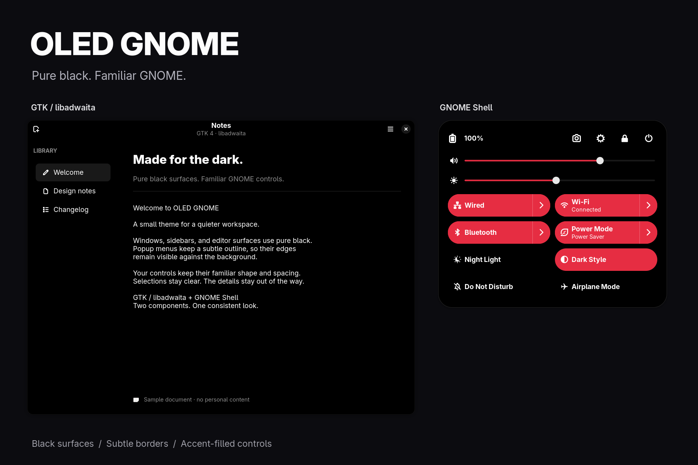

# OLED GNOME

Pure-black GTK/libadwaita surfaces and a matching GNOME Shell theme.



[Download](https://github.com/drkhn1234/oled-gnome/releases/latest) · [Screenshot gallery](promo/GALLERY.md)

The application theme keeps normal controls and selections, with a subtle outline around popup and right-click menus. The Shell theme uses black surfaces and inactive buttons, accent-filled enabled toggles, gray hover feedback, and lighter accent fills on hover. Top-panel buttons keep GNOME's default interaction style.

These are two independent components. You can install either one or both. No system-file replacement or patched libadwaita is needed.

## Compatibility

| Component | Tested on | Other versions |
| --- | --- | --- |
| GNOME Shell | 51.0 on Ubuntu 26.10 | Untested; Shell selectors and resource paths can change between releases |
| GTK 3 | 3.24.52, with Adwaita-dark | Other GTK 3 themes may render differently |
| GTK 4 | 4.24.1 | Older releases may reject CSS variables or render some widgets differently |
| libadwaita | Host library 1.10.0; visually checked in GNOME Text Editor 50.1 Flatpak | Individual applications and runtimes may differ |

## Quick start: both themes

1. Install Python 3 and GNOME Tweaks using your distribution's package manager. The helper needs only Python's standard library.
2. Install and enable the official [User Themes extension](https://extensions.gnome.org/extension/19/user-themes/), choosing the version for your Shell release. It lets GNOME Shell load a theme from your user directory. If you just installed the extension and GNOME does not see it yet, log out and back in.
3. Download the theme ZIP or tar.gz from the [latest release](https://github.com/drkhn1234/oled-gnome/releases/latest), extract it, and open a terminal in the extracted `oled-gnome` folder. You can check your Shell version with `gnome-shell --version`.
4. Review the files and preview the changes:

```sh
python3 theme.py install --dry-run
```

5. Install and activate:

```sh
python3 theme.py install --activate
```

Run as your regular desktop user, **without sudo**, inside your GNOME session. Activation selects Adwaita-dark for GTK, prefers dark appearance, and selects the OLED-GNOME Shell theme. It does not change your system accent preference or install/enable extensions.

Fully close and reopen GTK applications, including any app processes left running in the background. The Shell theme normally changes immediately. If it does not, log out and back in after saving your work.

The helper backs up the paths it replaces and records previous settings before activation. It refuses a second install until you uninstall the first one, so backups are not silently stacked or replaced.

## Install just one component

GTK/libadwaita only, without a Shell extension:

```sh
python3 theme.py install --component gtk --activate
```

GNOME Shell only, with User Themes already enabled:

```sh
python3 theme.py install --component shell --activate
```

To copy files without changing desktop settings, omit `--activate`:

```sh
python3 theme.py install
```

The GTK CSS takes effect when apps next start even without activation. With this option, choose dark appearance and Adwaita-dark yourself, and select **OLED-GNOME** under **Tweaks → Appearance → Shell**. Manual settings changes are not tracked for automatic restoration.

## What gets installed

The default paths below follow the XDG directory variables if you have customized them.

| Path | Purpose |
| --- | --- |
| `~/.config/gtk-3.0/gtk.css` | Replaced with one import of the packaged GTK 3 override |
| `~/.config/gtk-3.0/oled-gnome/` | GTK 3 palette and surface rules |
| `~/.config/gtk-4.0/gtk.css` | Replaced with one import of the packaged GTK 4 override |
| `~/.config/gtk-4.0/oled-gnome/` | GTK 4/libadwaita palette and surface rules |
| `~/.local/share/themes/OLED-GNOME/` | Shell stylesheet importing GNOME's built-in dark theme |
| `~/.local/state/oled-gnome/` | Install record, original files, and recovery copies |

Your existing `gtk.css` files are **backed up and replaced**, rather than merged, to avoid competing overrides. Other files in the GTK directories are left alone. Existing symlinks at the replaced paths are saved and restored as symlinks; the installer does not write through those links. Existing contents of the package's own `oled-gnome/` and `OLED-GNOME/` paths are also backed up before replacement.

GTK loads the per-user CSS paths described in the [GTK 3](https://docs.gtk.org/gtk3/class.CssProvider.html) and [GTK 4](https://docs.gtk.org/gtk4/class.CssProvider.html) documentation. That is how the application overrides work; there is no custom theme engine to install.

## Remove it and restore your setup

Keep the extracted folder and run:

```sh
python3 theme.py uninstall --dry-run
python3 theme.py uninstall
```

Use the same desktop user and XDG directory variables as during installation. The helper restores the backed-up files, removes paths that it newly created, and restores settings changed by `--activate` if their values have not since been changed again. Newer setting choices are left alone.

The currently installed files—including any edits you made—are saved under `~/.local/state/oled-gnome/recovered/` before restoration. Original backups are retained too. Reopen GTK apps afterward. If you selected the Shell theme manually, select your previous theme in Tweaks.

Do not delete the state directory before uninstalling: it contains your originals. If settings could not be restored because an extension or session is unavailable, the helper prints a warning and saves their previous values in `last-uninstall.json`. Restore them from a working desktop session.

## Colors and customization

- **Shell accent:** follows GNOME's accent setting. The red shown in the author's setup is a system preference, not a hardcoded red theme.
- **GTK 4/libadwaita accent:** the override leaves accent and selection colors to the application's base stylesheet. Libadwaita 1.6 and later follow the system accent, and GTK 4.24 exposes the desktop accent to plain GTK apps. Choose your accent in **Settings → Appearance**; applications with their own accent styling can still differ. Older GTK 4 or libadwaita versions may keep their default accent.
- **GTK 3 colors:** controls and list selections use neutral grays. GTK 3 does not have native GNOME accent integration; text selection and semantic actions keep the base theme's accent, with a blue `#007acc` fallback in the palette. To customize that fallback, edit the three `@define-color accent_*` definitions in `~/.config/gtk-3.0/oled-gnome/colors.css` and restart the app.
- **Shell hover:** inactive buttons use `#1a1a1a`; enabled controls lighten the current accent by 8%.
- **Borders:** GTK menu outlines use 7% white; the explicit Shell surface/card borders use `#242424`.

System accent behavior is described in the [libadwaita appearance guide](https://gnome.pages.gitlab.gnome.org/libadwaita/doc/1.10/styles-and-appearance.html#accent-color) and the [GTK 4.24 accent setting](https://docs.gtk.org/gtk4/property.Settings.gtk-accent-color.html).

The palette uses background/foreground pairs described in the [libadwaita CSS variables documentation](https://gnome.pages.gitlab.gnome.org/libadwaita/doc/main/css-variables.html). Restart apps after editing their CSS. To reload Shell edits, temporarily choose another Shell theme in Tweaks and then choose OLED-GNOME again.

## Ptyxis terminal

Ptyxis draws its terminal and window colors from a separate palette. To use black backgrounds, import the included palette:

```sh
ptyxis --import-palette palettes/ptyxis/OLED.palette
```

Select **OLED** under **Palette** in Ptyxis Preferences, or in the profile editor for a specific profile. It keeps colored terminal output and follows the system accent. The theme installer leaves terminal palettes alone; to undo this step, select your previous palette and remove `OLED.palette` from `~/.local/share/org.gnome.Ptyxis/palettes/` (or the equivalent path under `$XDG_DATA_HOME`).

## Troubleshooting

**User Themes is missing or activation fails.** Install and enable the official extension for your GNOME version. The helper checks activation requirements before changing files. Alternatively, install without `--activate` and use Tweaks after the extension becomes available.

**A GTK app still looks unchanged.** Quit every process belonging to the app and reopen it. Check whether it is a Flatpak, Snap, Qt, Electron, or custom-drawn application. A different theme manager may also be rewriting `gtk.css`.

**An app has poor contrast or a broken widget.** Uninstall the GTK override and retry. The global override cannot account for every application's private CSS.

**The Shell theme fails on another GNOME release.** Select the default Shell theme in Tweaks. This release was tested on Shell 51; other GNOME releases are untested.

**Install was interrupted.** The helper writes an install record before replacing files. If a record remains, run uninstall to restore the originals before trying again. Keep the backup directory intact.
