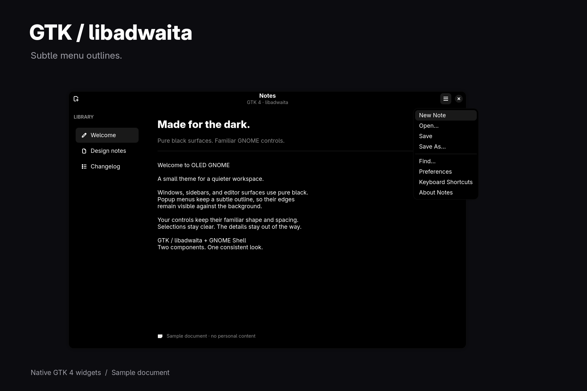
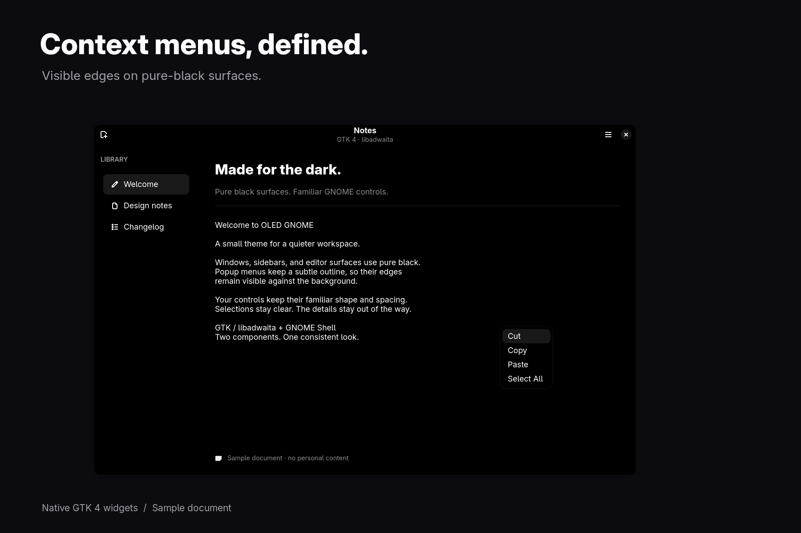
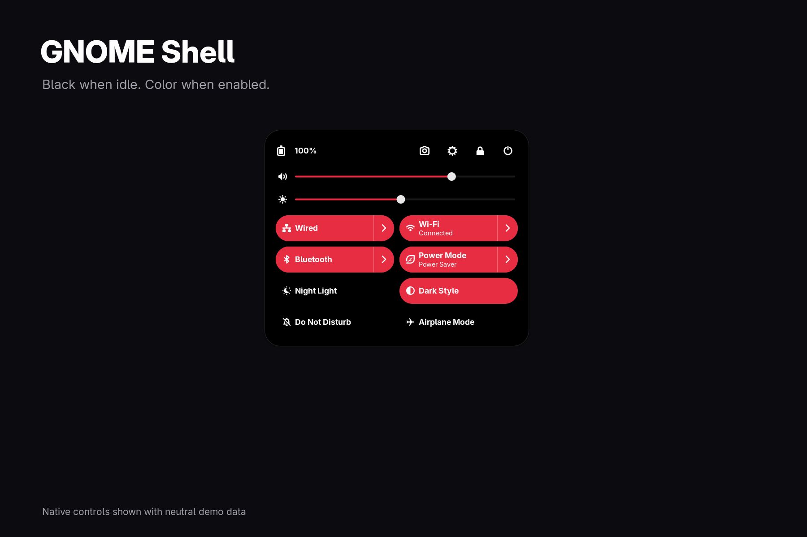
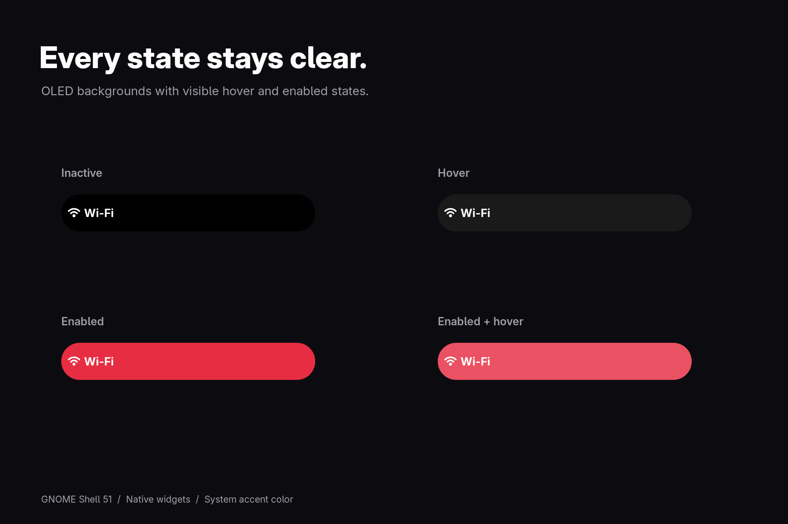
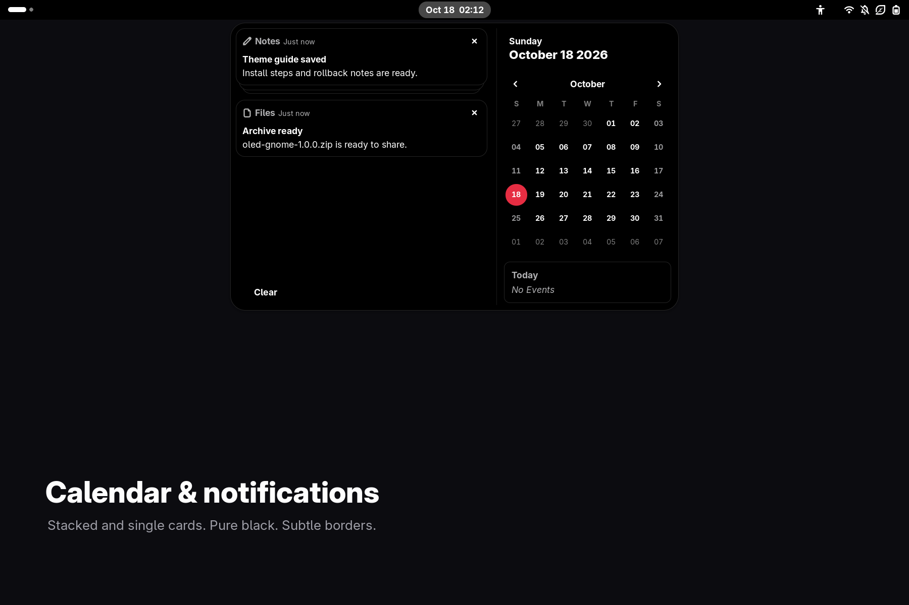
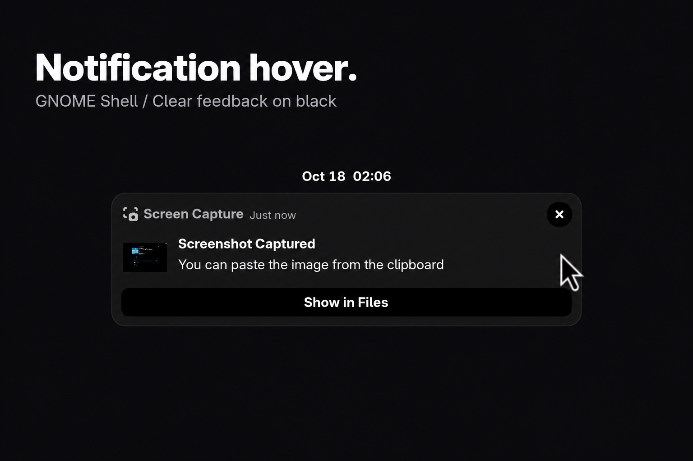
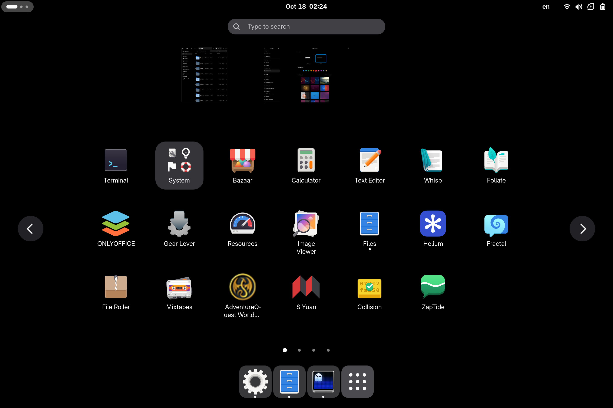
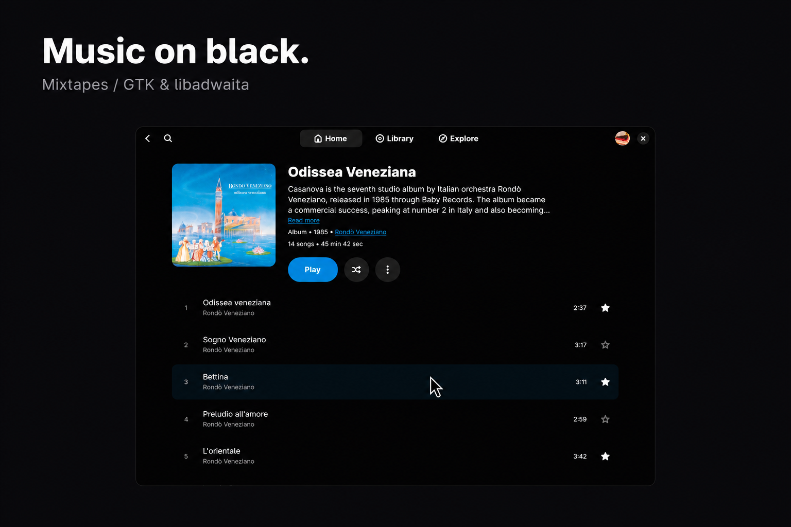
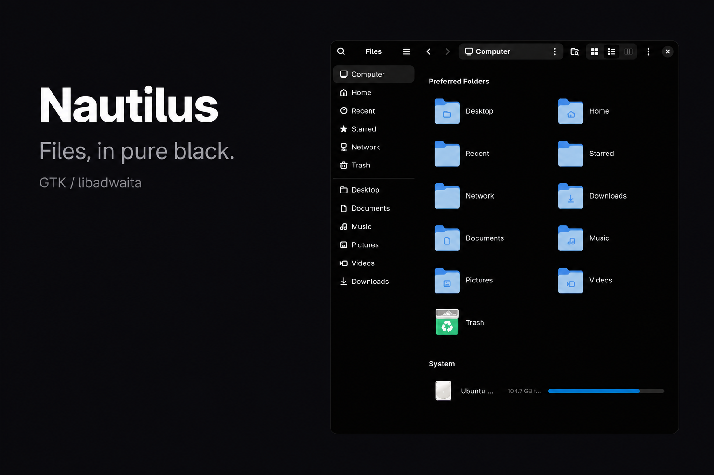
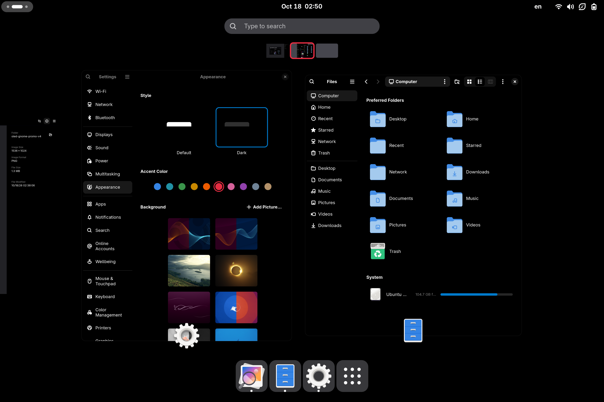

# OLED GNOME screenshots

## OLED GNOME

## GTK / libadwaita menus

## Context menus

## GNOME Shell quick settings

## Button states

## Calendar and notification cards

## Notification hover

## Applications

## Mixtapes

## Nautilus

## Workspace overview

